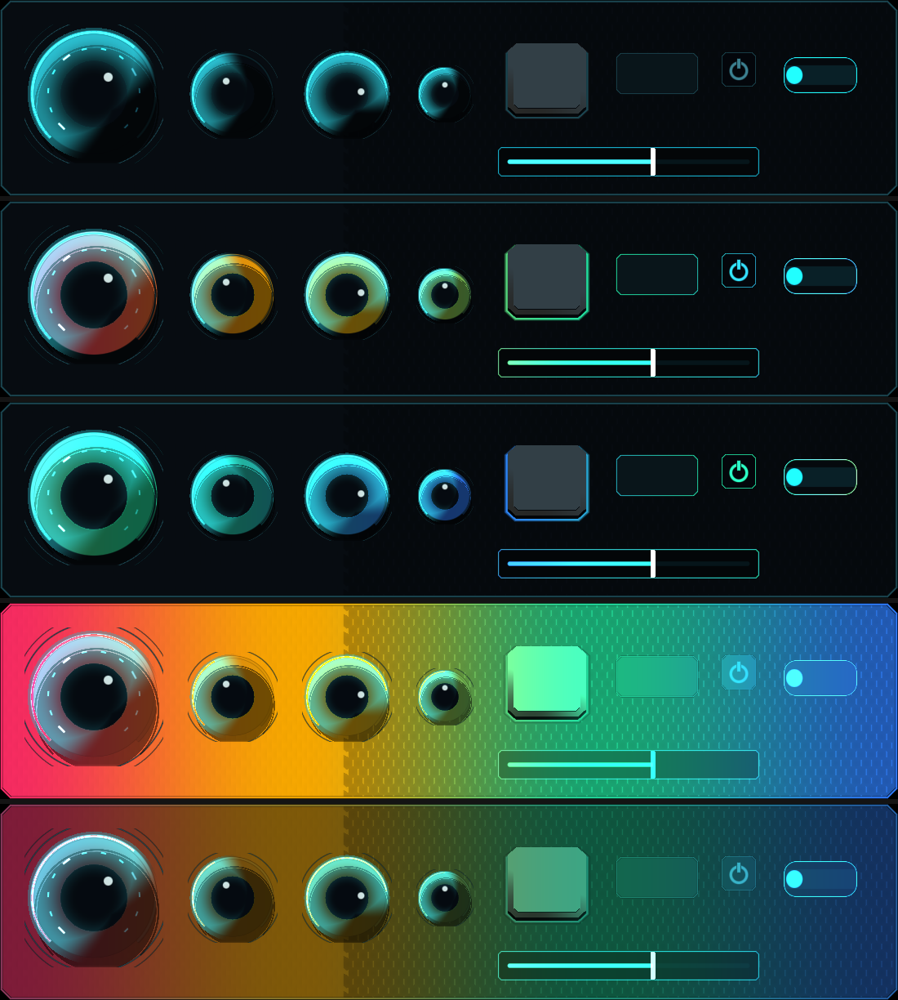
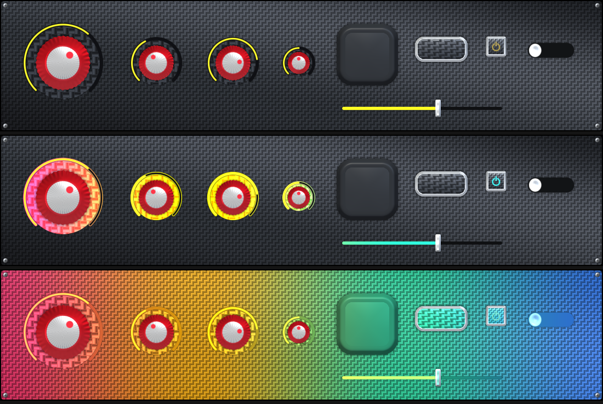

# Global FX — review of `*GlobalBlend` / `*GlobalIntensity` and a plan for screen-space "DJ controller" effects

Scope: every `UI/SDF*` shader. Everything below was read from the shader sources in this repo; the C# side
(`UiSceneDirector`, `UIShadowBufferManager`, canvas setup) lives in the Unity repo and is **not** visible here,
so anything that depends on it is marked *(verify in Unity)*. Pictures were rendered with slrender
(`Docs/GlobalFx/demo_sweep.py`), not Unity.

---

## 1. TL;DR

* The hook is real and cheap: **32 blend slots + 32 intensity slots** across 5 widget families (60 declarations across the 9 shaders, since the RM
  twins repeat them). Each slot is `lerp(slotBaseColor, globalGradientColor, blend * intensity)`, branch-skipped when
  `blend == 0`. **No shipped skin/theme sets any of them** — all 0, so today nothing renders differently.
* It already works as "a colour field in screen space that every participating slot can borrow". The rendered
  proof is in §6: rim glows + value indicators picking up a left→right colour flow across a whole rack, with
  lit materials (carbon weave, bevels, speculars) preserved.
* But it is **not yet usable as the director-driven effect you describe**. Four things need fixing first (§3):
  1. the "screen position" it uses is probably not screen position in the real app;
  2. blend is a per-material property, so animating 0→1 across 30 controls means writing 30 materials;
  3. the gradient can only make smooth 4-stop ramps — no travelling band, ripple, pulse or beat envelope;
  4. `Intensity` multiplies the *blend*, so >1 over-shoots the lerp instead of meaning "brighter/glowier".
* Recommended design (§4): keep the per-slot `*GlobalBlend` as an **authored participation weight** (theme
  data, per state), and add **one global `_GlobalFxAmount` + a small global FX uniform block** that a director
  animates. Slots become `lerp(base, fx.rgb * intensity, saturate(slotBlend * fx.mask))`. One `Shader.SetGlobal*`
  burst per frame drives the whole screen; no per-widget writes. It also *shrinks* the shaders (10 inlined
  gradient evaluations in the knob → 1).
* Catalogue of effects, what's worth doing and why (§7–§8), and a phased plan (§10).
* **Update (§11):** with your canvas settings the coordinate mapping is now exact, and the in-song use case
  (mostly-transparent global field + outward rings/glints from where you play or should look) is designed as a
  pooled ring system that fits the same slot weights.

---

## 2. Inventory — what exists today

Every slot is a pair `_<Slot>GlobalBlend` (Range 0–1, default 0) and `_<Slot>GlobalIntensity` (Range 0–2,
default 1). "RM" shaders have the same slots as their base twin.

| Family (shaders) | Slots (blend/intensity pairs) | Count |
|---|---|---|
| **Knob** (`SDFKnob`, `SDFKnobRM`) | `Fill` (centre disc), `Line` (arc track), `LineSublineFilled` (progress arc), `LineSublineUnfilled`, `Knob` (rotating body), `KnobEdge` (indent ring), `Nub` (pointer), `NubEdge`, `Edge` (indent behind everything), `Border` | 10 |
| **Button** (`SDFButton`, `SDFButtonRM`) | `Button` (body/face), `Icon`, `Edge`, `Border` | 4 |
| **Slider** (`SDFSlider`, `SDFSliderRM`) | `Bg`, `Track`, `TrackValueFilled`, `TrackValueUnfilled`, `TrackValueNegative`, `Handle`, `HandleFace`, `Edge`, `Border` | 9 |
| **Panel** (`SDFPanel`) | `Panel`, `InnerFrame`, `Edge`, `Border` | 4 |
| **Toggle pill** (`SDFTogglePill`, `SDFTogglePillRM`) | `Bg`, `Track`, `Handle` (also aliased as `_Toggle*`), `Edge`, `Border` | 5 |
| `SDFIcon`, `SDFScope`, `SDFRhythmTrack`, Backdrop*/Decor*/Decal* | **none** | 0 |

**Slots that look like they should exist but don't:** toggle **LED**, knob **OuterRing1–3** and **OuterMarks**
(scale ticks), slider **ScaleMarks**, `SDFScope` trace, `SDFRhythmTrack` (the highway — probably *should*
stay out, see §7.4), `SDFIcon`. The LED and outer rings/ticks are the most "controller-like" light sources in
the kit; adding slots there is the highest-value shader work (§10, phase 3).

### How a slot is evaluated today

```
// UIRenderer.cginc / every SDF*.shader (inlined per slot, not shared)
float4 CalculateGlobalGradient(float2 screenPos, float time) {
    float2 uv = screenPos / _ScreenParams.xy;
    t = GetGradientPosition(_GlobalGradientType, uv, _GlobalGradientDirection,
                            _GlobalGradientTime, /*speed*/1.0, _GlobalGradientScale, _GlobalGradientOffset);
    return InterpolateGradientColors(_GlobalGradientColorA..D, t, 4);   // ping-pong over 4 stops
}
base = lerp(base, gc.rgb, blend * intensity);   // then pattern → lighting → (edge/border) emissive
```

Driven by the plain uniforms in `UIGlobalUniforms.cginc` (`_GlobalGradientType/ColorA-D/Direction/Scale/Offset/Time`).
Gradient types: 0 linear, 1 radial, 2 angular, 3 diamond, 4 triangle. `t = dot(uv,dir)*scale + Time*0.1 + Offset`
(so `Time` moves the field 0.1 screen-widths per second; the ping-pong makes it bounce A→D→A).

**Where it lands in the pipeline matters for looks:**
* Body slots (`Knob`, `Button`, `Panel`, `Bg`, `Handle`, `Fill`…) replace the *base colour before pattern and
  lighting* → the sweep is "paint under the lights": weave, brushed metal, bevels and speculars all survive.
* `Edge`/`Border`/`KnobEdge`/`NubEdge` colours also feed the `*RenderEmissive` accumulators → they act as real
  **glow**, which is why rim-only sweeps look the most "lit".

Related code that is **dead today**: `UIGlobalEffects.cginc::ApplyGlobalEffects` (pulse, wave, vignette, grain,
scanlines, colour grade) is included by `UIRenderer.cginc` but called by nothing; `_GlobalPulse*`,
`_GlobalWaveParams`, `_GlobalEffectMask`, `_GlobalGlitch*`, `_GlobalPixelSize` are declared and unused by the widgets.
This is the half-built version of what you want — see §4.3.

---

## 3. Problems to fix before building on it

### 3.1 The "screen position" is not screen position *(now pinned down for your canvas — see §11.1)*
Every call is `CalculateGlobalGradient(IN.worldPosition.xy, …)` and the vertex shader does
`OUT.worldPosition = v.vertex` — i.e. the **batched canvas-local vertex**, not a pixel. It is then divided by
`_ScreenParams.xy`. That is only a 0..1 screen UV if the canvas is Screen-Space-Overlay, scale factor 1, and the
mesh origin is the screen's bottom-left. In a normal UI the canvas origin is its pivot (centre) and a
`CanvasScaler` changes the units, so you would get: the sweep centred on the middle of the screen (negative UVs
left/below), compressed or stretched by the scaler, and a *different* effect on each aspect ratio. Camera-space
canvases would use world units and break it completely. In **slrender / SkinSheet it is 0..1 per cell**, so
every control sees only the first ~0.001 of the gradient — a sheet can never show a spatial sweep as-is.

*Recommendation:* give the shader an explicit mapping from `worldPosition.xy` to screen UV, set once per frame by
the director: `float4 _GlobalFxMap` (`uv = worldPosition.xy * map.xy + map.zw`). Overlay, scaled and camera
canvases then all work, and slrender can set the same global to emulate any screen (that is how the pictures in
§6 were made).

### 3.2 One slot in `SDFButtonRM` uses the wrong coordinate
`SDFButtonRM.shader:1174` (the raymarched body) calls `CalculateGlobalGradient(uv, time)` with the widget's own
0..1 UV, while its Edge/Border and every other shader use `IN.worldPosition.xy`. A button body would therefore
show a near-flat colour instead of its position in the sweep. Fixed for free by §4.2 (all slots read one shared
`screenUV`).

### 3.3 Blend is per-material; an effect needs a global switch
To fade 30 controls 0→1 you must touch 30 `Material` instances (or `MaterialPropertyBlock`s) every frame, *and*
those values collide with the state system (Hover/Pressed parameters are written into the same properties).
A global multiplier removes both problems (§4.1).

### 3.4 `Intensity` over-shoots
`lerp(base, g, blend*intensity)` with `intensity` up to 2 extrapolates: `blend=1, intensity=2` → `2g − base`, which can
go negative/clipped and shift hue. In `ApplyGlobalEffects` (unused) intensity is a brightness multiplier on the
gradient — a better meaning. Since every existing value is `blend=0, intensity=1`, redefining it changes no pixel
today (parity-safe).

### 3.5 The ramp can't make "one colour moving across"
Four smooth stops, ping-pong, speed 0.1/s: great for rainbow/flow, but a travelling *band* (the classic
chase/wipe), a ripple ring, or a beat-synced pulse needs an envelope (mask) as well as a colour. Today it can be
faked with stops `dim,dim,hot,dim` but the band width/speed are tied to `scale`/`Time` and can't be driven by a
curve. Crossing the screen in 1.5 s needs `Time` at ~6.7× — workable but awkward.

### 3.6 Smaller notes
* `SDFTogglePill`: the *Track* component's gradient call hard-codes `globalBlend=0` and applies the global
  separately to the base colour (Params-Toggle.md:249) — fine, just be aware pattern/bevel on the track is not tinted.
* `SDFSliderRM` evaluates the global in 9+ separate inlined blocks (`TrackValueFilled` alone is inlined at several sites). Knob RM: 10.
  Each is branch-gated, so off = free, but with many slots on it is 10 gradient evaluations per pixel and
  more unrolled code for FXC (CLAUDE.md: the RM shaders are already ~9–10 min of Unity's compile budget).
* The legibility rules (`lookcheck` print pairs ≥3:1, 30 px indicators) only audit *static* colours. An effect
  that recolours `Icon`/`Fill`/`TrackValueFilled` can drop below 3:1 against its background mid-sweep (§7.5).

---

## 4. Recommended design

### 4.1 Two layers: authored weight × runtime amount

| Layer | Who sets it | When | Meaning |
|---|---|---|---|
| `_XxxGlobalBlend` (existing, per slot) | **theme / skin** (`*.states.json`, per state) | author time | *"How much does this part take part in a screen-wide effect?"* — a weight, 0 = never |
| `_XxxGlobalIntensity` (existing, per slot) | theme / skin | author time | *"How hard does it light up?"* — gain on the FX colour (glow strength); 0–2 |
| `_GlobalFxAmount` (**new**, global float) | **director** | runtime | master fade 0→1→0 (attack/hold/release) |
| `_GlobalFx*` block (**new**, globals) | director | runtime | the effect itself (colours, phase, width, mode, origin) |

Shader side (one tiny function, shared by every slot):

```hlsl
// computed ONCE per fragment, only when _GlobalFxAmount > 0.001
float4 fx = GlobalFx(screenUV);                 // rgb = colour, a = spatial mask 0..1
// per slot (replaces the inlined CalculateGlobalGradient):
float w = saturate(slotBlend * _GlobalFxAmount * fx.a);
base = lerp(base, fx.rgb * slotIntensity, w);   // intensity = glow gain, not blend gain
```

* `_GlobalFxAmount == 0` (the default) ⇒ every slot is skipped ⇒ **frozen Unity goldens stay identical**.
* Old behaviour stays reachable: keep the legacy `_GlobalGradient*` as FX *mode 0* (full-mask rainbow), so any
  skin that sets blend today (none do) behaves as before.
* Hover/Pressed are just states that carry different weights — no extra machinery (§5).

### 4.2 Shared screen UV
`float2 screenUV = IN.worldPosition.xy * _GlobalFxMap.xy + _GlobalFxMap.zw;` computed once per fragment, passed to
`GlobalFx`. Fixes §3.1/§3.2 and costs nothing.

### 4.3 The FX uniform block (proposal)

| Uniform | Type | Meaning |
|---|---|---|
| `_GlobalFxAmount` | float | master 0..1 (director envelope) |
| `_GlobalFxMode` | int | 0 gradient field (legacy), 1 band, 2 ring/ripple, 3 wash, 4 beat-pulse, 5 target-converge |
| `_GlobalFxColorA..D` | float4×4 | palette (usually the theme's accent set) |
| `_GlobalFxPhase` | float | 0..1 position of the front, driven by a curve (or beat phase) — *not* wall-clock |
| `_GlobalFxWidth`, `_GlobalFxSoft` | float | band half-width / edge softness |
| `_GlobalFxDir` | float2 | sweep direction (modes 0/1) |
| `_GlobalFxOrigin` | float2 | centre for ring/ripple/converge, in screen UV |
| `_GlobalFxMap` | float4 | `worldPosition.xy → screen UV` (§3.1) |
| `_GlobalFxGroups` + per-widget `_GlobalFxGroup` *(optional)* | float bitmask | lets an effect include only some widget kinds (§4.4) |

Mask/colour per mode (all a few ALU):
`band: a = 1 − smoothstep(w, w+soft, |dot(uv,dir) − phase|)`, colour = ramp(position in band);
`ripple: a` same with `length(uv−origin)`; `wash: a = 1`, colour = single stop; `beat: a = pow(1−beatPhase, k)`;
`converge: ring radius = (1−phase)*R shrinking onto the target`.

### 4.4 "Do an effect in screenspace and include these UI elements"
Three levels, pick the cheapest that suffices:
1. **By authoring (default, zero code):** a control participates iff its slots have `GlobalBlend > 0` in the
   current theme/state. Choose the set when you author the theme.
2. **By group (optional):** one `_GlobalFxGroup` float on each material (bitmask: knobs=1, buttons=2, sliders=4,
   pads=8, panels=16, toggles=32…) and a global `_GlobalFxGroups` from the director. Shader gate:
   `(group & mask) != 0`. Lets the same theme run a "knobs only" sweep.
3. **By instance (exceptional):** the director writes `_GlobalFxGroup` on specific materials (e.g. "the one control
   the tutorial is pointing at"). Per-widget writes only on the rare targeted effect.

### 4.5 Compile-budget impact
Hoisting the effect to one `GlobalFx()` per fragment *removes* ~10 inlined gradient evaluations from
`SDFKnob(RM)` and ~9–15 from `SDFSlider(RM)`. Expect FXC time to stay flat or drop. It still needs the Unity
compile check CLAUDE.md requires, and a `tests/parity.py check` run (should be byte-identical: amount defaults to 0).

---

## 5. Theme authoring: which slots should take part

Principle: **light the lights, tint the paint, never touch the readouts.**

| Role | Slots | Weight (Normal) | Intensity | Why |
|---|---|---|---|---|
| **Rim lights** | `Edge`, `Border`, `KnobEdge`, `NubEdge`, (new) LED | 0.8–1.0 | 1.0–1.6 | feed the emissive accumulator → real glow; the DJ-controller look |
| **Indicators** | `Fill`, `Line`, `LineSublineFilled`, `TrackValueFilled`, `Icon`, `Nub` | 0.6–1.0 but **gate on luminance contrast** (§7.5) | 1.0 | these *are* the colour accent most themes already have; moving it feels alive |
| **Paint** | `Knob`, `Button`, `Handle`, `HandleFace`, `Panel`, `InnerFrame`, `Bg` | 0–0.35 | 1.0 | subtle wash; bodies keep material identity. ≥0.5 floods the panel (see §6, row 4) |
| **Readout backdrops** | `Track`, `TrackValueUnfilled`, `TrackValueNegative`, `LineSublineUnfilled` | 0 | — | must stay dark/neutral so a value is readable at 30 px |

**States** (existing `Normal` / `Hover` / `Pressed` / `Disabled` from the skin state system):
* `Normal`: weights above.
* `Hover`: rim lights ↑ (e.g. 0.8 → 1.0) and intensity ↑ — a hovered control "wakes up" a bit more than its
  neighbours, even mid-effect.
* `Pressed`: **blend → 0 on the pressed colour slots** (or a fixed theme flash). Direct feedback must beat ambient
  eye-candy; the player should never lose "I pressed this".
* `Disabled`: 0 — a disabled control that keeps glowing reads as enabled.

**Per-theme palette**: the director should read four colours from the theme (the look's own accent family — Tron
cyan/magenta/…, Carbon red/yellow/white/silver…), not use a rainbow by default. Suggest a `globalFx` block in the
theme JSON (`Themes/*.theme.json`, currently only `scene`):
`{"globalFx": {"palette": ["#..","#..","#..","#.."], "idle": "flow", "intensityScale": 1.0, "reduceMotionSafe": true}}`.

---

## 6. What it looks like (slrender, not Unity)

Setup: whole rack ≈ 1100×240; each cell rendered with `_ScreenParams = screen/cell` and `_GlobalGradientOffset += x0/W`
so the per-cell local coordinate becomes a true screen coordinate (this is the §3.1 emulation).
4 stops `#FF2D6A #FFB000 #22E0A0 #2E7BFF`, linear L→R. Rows: **off · rim+indicators @ 1.0 (phase 0) · same, phase +0.5
· every slot @ 1.0 · every slot @ 0.5**.





What this tells us:
* **Row 2–3 (rim + indicators):** exactly the "DJ gear" read — the rings/rims/value arcs/borders pick up the sweep,
  bodies stay put. Best look and best legibility. This should be the default participation set.
* **Rows 4–5 (all slots):** the whole panel becomes a gradient poster. On the lit Carbon rack at 0.5 it is still
  gorgeous — weave pattern and speculars survive — but it hides the control hierarchy, so use it as a brief
  full-screen *event* (transition, drop, combo), not an idle state.
* The knob `Fill` ring and slider `TrackValueFilled` turn into live colour bars, which is where the sweep is most
  noticeable at small sizes.
* Not shown / unverified: motion (stills only), Unity FXC behaviour, and the real-canvas coordinate mapping
  (§3.1). An unexplained vertical discontinuity in the Tron face panel at x≈420 appears with the panel's own blend
  on; I did not chase it.

---

## 7. Effects worth building — and why

Ranked by (benefit ÷ cost). "Purpose" is the answer to *why would I ship this*.

| # | Effect | Look | Purpose / benefit | Trigger |
|---|---|---|---|---|
| 1 | **Beat pulse** — rim lights ease up/down with `beatPhase`, palette steps per bar | rack "breathes" with the track | peripheral **tempo reference**; makes the UI feel *wired to the audio* (the single most convincing DJ-hardware cue) | every beat, while a track plays; amplitude low (weights ≤0.5) |
| 2 | **Sweep L→R** — one bright band, 1–1.5 s, rim+indicator slots | classic controller boot/attract chase | **boot/ready cue**, screen/preset transitions (masks the swap), "loaded" confirmation | scene enter, preset load, theme switch |
| 3 | **Converge** — ring or band shrinks *onto a target control* | eye is pulled to one control | real **attention/onboarding** tool: first-run hints, "tap here", missed-step reminders; replaces ad-hoc arrows | tutorial step, idle-hint after N s |
| 4 | **Rainbow flow** (the §6 demo) — slow 4–6 s palette scroll | idle light show | **attract/idle mode**; moving colour also reduces static burn-in on OLED handhelds | no input for ~20–30 s; any touch fades out in 0.3 s |
| 5 | **Ripple from source** — ring emanates from a pressed pad/button | physical "touch splash" | feedback that is **spatially tied to what you did** (works as hit feedback in a rhythm game without touching the highway) | pad hit, perfect/good grade |
| 6 | **State wash** — whole rack tints to one colour (low weight) | mode colour | **mode/status signalling at a glance**: record-armed = red, sync-locked = green, deck A cyan / deck B magenta, low-battery amber | state change, persistent while true |
| 7 | **Milestone flash** — rainbow sweep, once | celebration | combo/streak/level-up reward without a popup; miss streak = brief red wash | combo thresholds, song end |
| 8 | **Level/meter chase** — front position = audio RMS or progress | rack acts as a VU / song-progress bar | ambient **progress/energy** display with zero extra widgets | continuous (optional) |

**Is random/untriggered worth it?** Only #4 is fine as purely idle "eye-candy" — rare, long, and it self-cancels on
input. Everything else earns its place by carrying information (beat, state, attention, reward). Random flashes during
play would compete with the highway and train players to ignore the glow, which would waste #3/#6.

### 7.4 Keep these out
* `SDFRhythmTrack` (the highway/notes): colours there encode gameplay (lanes, timing). Do not add global blend.
* Anything where colour = data: pitch/lane colours, value-negative indicators, error/disabled colours.

### 7.5 Guardrails (cheap, do them with the first implementation)
* **Photosensitivity:** cap flash/pulse rate (≤ 3 Hz, no full-screen red/white strobing); expose a "reduce motion"
  setting that disables #1/#4/#5 and shortens #2 to a single fade.
* **Legibility:** don't blend `Icon`/glyph slots at weight >0.5 unless the FX palette is luminance-matched to the
  background; extend `lookkit`'s printcheck with a "worst case against the FX palette" pass once palettes exist.
* **Interaction wins:** `Pressed` zeroes the weight on the pressed colour slots (§5).
* **Cap participation per frame:** effect amplitude ≤0.6 during gameplay, up to 1.0 only in menus/transitions.

---

## 8. Director sketch (Unity side — to be written in the audiogame repo)

```csharp
UiGlobalFx.Play(FxPreset preset, float duration, FxGroups groups = All, Vector2? origin = null);
// FxPreset = { mode, palette (from theme), width/soft, ease curves, attack/hold/release, loop }
```

* One component, one `Update()`: evaluates curves → `Shader.SetGlobalFloat("_GlobalFxAmount", …)`, `_GlobalFxPhase`,
  `_GlobalFxOrigin`, colours (only when changed), and `_GlobalFxMap` on resolution/scaler change. **No per-widget writes**
  in the common case.
* Envelope: `attack 0.25–0.5 s → hold → release 0.6–1 s`; `Cancel()` = release in 0.2–0.3 s (used by any user input
  while the effect is "idle").
* Presets are data (ScriptableObject/JSON next to themes), so a look can ship its own sweep timing and palette.
* Beat input: `_GlobalFxPhase` = `beatPhase` for mode 4, supplied by the audio clock, not `Time.time`.
* Priority: `Milestone > State wash > Beat pulse > Idle flow`; higher priority ducks lower ones.

---

## 9. Verifying it in this repo (no Unity)

* slrender already layers `globals` over a material and takes `cell["globals"]`; the §6 harness is
  `python Docs/GlobalFx/demo_sweep.py <SkinPrefix>` (writes to `Docs/GlobalFx/.out/`). With `_GlobalFxMap` in place it
  becomes trivial to add `Tools/looks/<look>.py fxsheet` that renders N phases per rack for review.
* Parity: all new uniforms default to "off" ⇒ `python tests/parity.py check` must pass unchanged. Anything that
  moves a pixel (e.g. fixing `SDFButtonRM` body to world-space) will only differ when blend>0, i.e. never in goldens.
* PR note required by CLAUDE.md: which shaders grew/shrank, and that a **Unity FXC compile check is needed**.

---

## 10. Phased plan

1. **Foundation (shader, small, parity-safe):** `GlobalFx()` + `_GlobalFxAmount/Map/Mode/Phase/Width/Origin/Colors`
   in `UIGlobalUniforms.cginc`/`UIRenderer.cginc`; replace the dozens of inlined `CalculateGlobalGradient` calls with a
   single per-fragment `fx`; fix §3.2; change Intensity to a gain on `fx.rgb`. Gate everything behind
   `_GlobalFxAmount > 0.001`.
2. **Proof in slrender:** `fxsheet` helper; render the 8 effects × (Tron, CarbonRace, one lit look, one flat look).
3. **More lights:** add blend/intensity slots to toggle **LED**, knob **OuterRing1–3** / **OuterMarks**, slider **ScaleMarks**
   (opt-in, defaults 0).
4. **Theme data:** `globalFx` palette/idle preset in each look's `Themes/*.theme.json`; set slot weights per the §5 table
   in each look's `Tools/looks/<look>.py` spec (the kit builds the states — do not hand-edit).
5. **Unity director + presets + reduce-motion setting** (audiogame repo).
6. **Then** decide which triggers to wire (suggested order: scene-enter sweep → beat pulse → idle flow → target converge →
   milestone).

### Open questions for you
(The canvas and in-song questions are answered — see §11. Remaining:)
* Typical hit rate / simultaneous touches on the busiest charts? (Sets the ring pool size, §11.3.)
* Do you want per-theme palettes only, or also a user-chosen "deck colour"?
* Should a ring ever be *tinted by the grade* (perfect/good/miss), or stay one theme colour? (§11.5)

---

## 11. Update — your canvas settings and the in-song ring/glint use case

### 11.1 The coordinate mapping, exact
Your setup: **Screen Space – Overlay, CanvasScaler = Scale With Screen Size, 1920×1080 reference, match = 1 (height),
100 reference pixels per unit.** What that means for the shaders (standard Unity behaviour; still worth one
`Debug.Log` check in the Unity editor):

* `scaleFactor = Screen.height / 1080`. Canvas units are **reference pixels, 1080 units tall at every resolution**;
  the canvas is `1080 × aspect` units wide (1920 at 16:9, 2400 at 20:9, …).
* Batched UI vertices (`v.vertex` → `worldPosition`) are in **canvas-local units with the origin at the canvas
  centre** → `worldPosition.xy` spans `x ∈ [−W/2, W/2]`, `y ∈ [−540, 540]` (W = 1080·aspect).
* *Pixels per unit = 100* only affects sprite sizing; it has **no effect** on these shaders.

What today's code does with that: `uv = worldPosition.xy / _ScreenParams.xy`.
* At exactly 1920×1080: `uv ∈ [−0.5, 0.5]` — the gradient is **centred on the screen centre**, and because the ramp
  ping-pongs (`abs`) a left→right sweep is **mirrored about the middle**.
* At any other size (e.g. 2560×1440, or a phone) the divisor is *physical* pixels but the numerator is *reference*
  units, so the field is also **scaled wrong** (×0.75 at 1440p, and a different amount per axis on other aspects).

**Fix (exact, aspect-independent):**
```csharp
// director, on resolution/orientation change (and once at start)
float h = 1080f, w = 1080f * Screen.width / Screen.height;      // canvas size in units
Shader.SetGlobalVector("_GlobalFxMap", new Vector4(1f/w, 1f/h, 0.5f, 0.5f));
// better: read the real numbers from the root canvas rect: canvasRT.rect.width/height
```
```hlsl
float2 screenUV = IN.worldPosition.xy * _GlobalFxMap.xy + _GlobalFxMap.zw;   // 0..1, origin bottom-left, y up
float2 canvasPx = IN.worldPosition.xy;                                       // reference px, origin centre
```
Because match=1 keeps the vertical scale constant, **anything defined in canvas units looks identical on every
device** (a 160-unit ring is the same fraction of screen height everywhere). So: use `screenUV` for full-screen
gradients/sweeps, and **canvas units for rings and glints** (they stay round at any aspect; no aspect correction
needed). The director never converts to pixels: a widget's canvas position
(`rectTransform.position` relative to the canvas, or `RectTransformUtility.ScreenPointToLocalPointInRectangle`
for a touch) is already the ring origin.

*Gotcha:* a control inside a nested `Canvas` or a scaled/rotated parent still batches into the **root** canvas space;
a separate sub-canvas with its own render batch may not. Check any such panels (scroll views, pop-ups) once.

### 11.2 The in-song system: a mostly-transparent field with rings and glints
This is the same slot machinery with a different field: instead of a ramp covering the whole screen
(`fx.a ≈ 1`), the field is **almost everywhere 0** and contains a handful of moving shapes.

```
fx.a   = Σ over active events of  shape(distance/angle, age)     // 0 almost everywhere
fx.rgb = palette colour of the event with the largest contribution
slot:  base = lerp(base, fx.rgb * slotIntensity, saturate(slotBlend * _GlobalFxAmount * fx.a))
```
`_GlobalFxAmount` simply stays at 1 for the whole song (or is the user's "effects" slider); the *events* are the
dynamic part. Only parts with slot weights > 0 react, so the rings light up the **rims, indicators and a little paint**
as they pass over — rings visibly "travel through the hardware" without ever drawing on the highway or touching readout
backdrops. The pressed control itself has its weight zeroed by the `Pressed` state (§5), so the thing you hit keeps its own
feedback and its **neighbours** answer.

Shapes (all closed-form, a few ALU):
* **Ring (shockwave):** `r = |p − origin|` (canvas units), `front = age·speed`;
  `a = strength · (1−age/life)^k · smoothstep(width,0,|r − front|)` — thin bright leading edge.
  Optional soft trail: add `0.35 · smoothstep(0, trail, front − r)` for the lit wake behind the front.
* **Glint:** a ring *segment* — multiply the ring by an angular window around a direction
  (`smoothstep(halfAngle, 0, |wrapAngle(atan2(p−origin) − dir)|)`), plus a narrow hotter core. Reads as a spark of
  light skimming outward across the hardware. 1–3 glints per ring at random directions (seeded by the event id,
  so the director sends nothing extra).
* **Converge / "look here":** ring radius *decreasing* onto a target (`front = R0·(1−age/life)`), same shape.
  Soft, slow and repeating once or twice — it reads as a beckoning pulse, not an alarm.
* **Trail:** a finger drag spawns a ring every N ms along the path (rate-limited), each small and short.

### 11.3 Event pool (no per-frame CPU work, no per-widget writes)
Shader-side event table, set only **when an event spawns**; the shader computes age itself:

| Global | Type | Meaning |
|---|---|---|
| `_GlobalFxEvents[N]` | `float4[]` | `xy` origin (canvas units), `z` start time, `w` packed `life`/`speed`/`width` or an index into a small preset table |
| `_GlobalFxEventData[N]` | `float4[]` | `x` strength, `y` palette index 0–3, `z` kind (ring/glint/converge), `w` seed/direction |
| `_GlobalFxEventCount` | int | live events; **0 ⇒ skip all FX work** |
| `_GlobalFxTime` | float | `Time.timeAsDouble` truncated, set once per frame (don't rely on `_Time`: Unity's `_Time.y` is level-load-relative and may differ from the C# clock) |

* **N = 8** to start (unrolled loop, ~8×(sqrt + smoothstep) per participating fragment). A ring older than its
  `life` contributes 0, so the director just overwrites the oldest slot (round-robin); nothing is ever "cleared".
* `Shader.SetGlobalVectorArray` only on spawn (cheap; not per widget, not per frame).
* **Cost control:** each widget computes `anyW = max(all its slot blends)` first and **skips the event loop when
  `anyW·_GlobalFxAmount == 0`** — panels/toggles whose theme doesn't opt in pay nothing, and a quiet moment
  (`EventCount == 0`) costs one compare. Hoist it once per fragment, not per slot (§4.5).
* Spawn budget (director side): max 8 live, min 60–80 ms between spawns, drop lowest-strength first. At very dense
  charts, rings from *every* note would be noise — spawn per beat/measure for the dense stretch, per hit for the sparse.

### 11.4 Safety and readability (matters more now: it runs during play)
* **Local, not global:** a ring touches a small area for 0.4–0.8 s, so unlike a full-screen flash it is not a
  photosensitivity risk. Still cap: ≤ 3 spawns/s of high-strength events, peak `slotIntensity ≤ ~1.4`, no white-hot
  full-saturation flashes; "reduce motion" ⇒ rings become a single non-moving fade-in/out at the origin.
* **Never over the notes:** rings only light widgets through slots, and `SDFRhythmTrack` has no slot — the lanes and
  notes stay untouched. Keep the HUD *readout* slots (§5, readout backdrops) at weight 0 so combo/score contrast is
  unaffected.
* **Contrast rule still applies** to `Icon`/`Fill` slots; ring colours should come from the look's accent palette
  and be luminance-checked against that look's backgrounds.
* **Priority:** an attention/converge event outranks a hit ring in the same pool slot choice; hit rings never evict an
  active converge.

### 11.5 What to use it for (ranked, in-song)
| # | Event | Origin | Colour | Purpose |
|---|---|---|---|---|
| 1 | **Hit ring** | the pad/lane/finger you played | palette A (theme accent); optionally brighter for perfect | spatial confirmation that you *hit that spot*, felt in peripheral vision; reinforces timing without reading a label |
| 2 | **Glints on perfect/streak** | same, outward at random angles | palette B (hot) | reward gradient: normal hit = ring; perfect = ring + glints; milestone = ring + glints + wider front |
| 3 | **Converge / look-here** | the control or lane to attend to (upcoming section, tutorial target, mode change, a mixer control that needs adjusting) | palette C, slow | guides attention *without* a popup or arrow |
| 4 | **Beat ripple** | screen centre or the metronome/tempo widget, once per bar | dim palette D | tempo anchor; replaces the screen-wide "pulse" of §7 with something that cannot strobe |
| 5 | **Miss / error** | the missed lane/control | red-ish, small, *inward* (converge) | non-punishing negative feedback; inward motion reads differently from reward |
| 6 | **Drag trail** | finger path | A | tactile polish on sliders/knobs being dragged (rate-limited) |

Grade-tinted colour is optional; the simplest strong version is **one accent, size/strength = grade**. Adding hue per
grade costs nothing in the shader (palette index) but adds colour-blind considerations — encode grade in
*shape/size* first, hue second.

### 11.6 Updated slot guidance for in-song use
Same table as §5, with these adjustments: rim-light slots at weight 0.8–1.0 are what make the rings read; indicator
slots (`Fill`, `LineSublineFilled`, `TrackValueFilled`) at ~0.5 so a ring passing a *value arc* doesn't look like the
value changed (differentiate by keeping the ring's colour ≠ the value colour in each theme's palette); paint slots at
0.1–0.25 for the subtle "surface catches the light" look; readout backdrops 0.

### 11.7 Changes to the plan in §10
1. Phase 1 gains: `_GlobalFxMap` computed as in §11.1, canvas-unit `p`, the event table and the ring/glint/converge
   shapes (kinds 0–2) behind `_GlobalFxEventCount > 0`.
2. Phase 2 (slrender proof): render rings by passing `_GlobalFxEvents` as globals — slrender can already set
   arrays of vec4 only if the uniform packer accepts them; if not, emulate with 1–2 events per sheet (needs a
   check; not yet done). Stills at ages 0.1/0.25/0.5/0.8 of one ring + two glints over the Tron and Carbon racks.
3. Phase 5 director gains `SpawnRing(canvasPos, kind, strength, paletteIdx)` and the spawn budget (§11.3).
4. Verification in Unity: log `canvas.rect` and one widget's `worldPosition` at 1920×1080, 2560×1440 and a 20:9 phone
   to confirm §11.1, and confirm FXC time of `SDFKnobRM`/`SDFSliderRM` after the hoist.

*Not verified in this session:* none of §11 has been rendered or compiled — it is design built on the shader sources
and your canvas settings. The rings/glints in particular are untested; the slrender stills in §6 only prove the
slot-weight/lighting behaviour of the *gradient* field.
